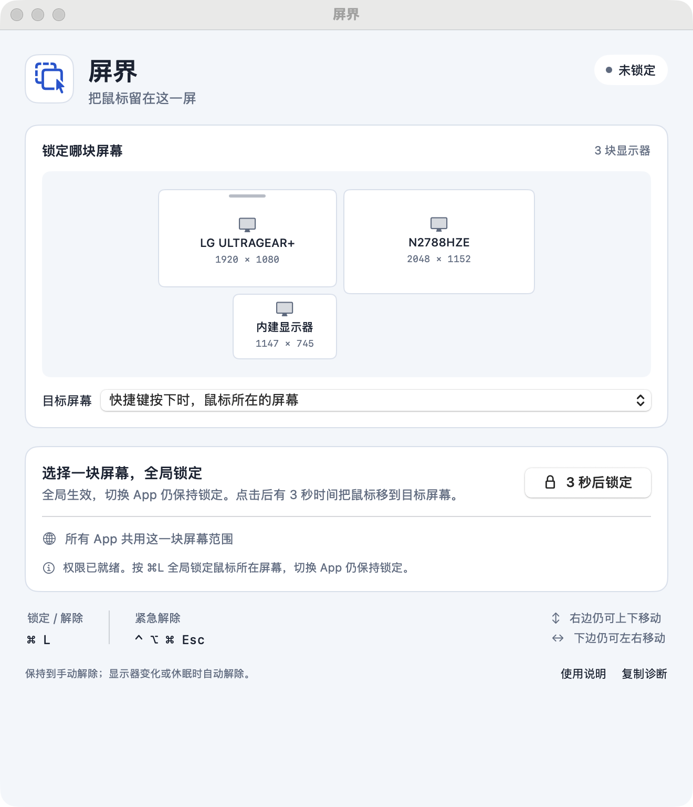
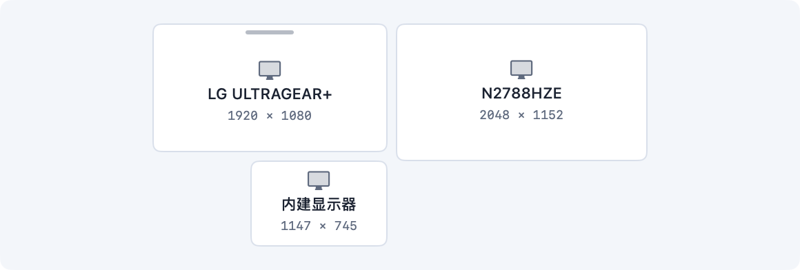

# 屏界 ScreenFence

一个 macOS 菜单栏工具，把鼠标临时锁定在一块显示器内。锁定全局生效，适合多屏游戏、远程桌面等场景；切换 App 或关闭设置窗口后仍保持锁定，直到手动解除。

当前版本：**1.2.3（构建 6）**。需要 **macOS 14 或更新版本**。



## 使用

1. 打开 `屏界.app`，点击「开启权限」，在「系统设置 → 隐私与安全性 → 辅助功能」中允许「屏界」。
2. 回到屏界，确认权限已就绪。
3. 将鼠标移到要锁定的屏幕，按 **Command + L**；再按一次解除。

| 操作 | 快捷键 |
| --- | --- |
| 全局锁定 / 解除 | Command + L（⌘L） |
| 紧急解除 | Control + Option + Command + Escape（⌃⌥⌘Esc） |

也可以点击「3 秒后锁定」，在倒计时内把鼠标移到目标屏幕。通过显示器示意图或下拉菜单可指定目标；指定后，鼠标需先移入那块屏幕才能锁定。默认目标是按快捷键时鼠标所在的屏幕。

锁定时菜单栏只显示图标。需要跨屏时先解除锁定；退出屏界也会解除。



## 锁定行为

- 对所有 App 生效，切换前台 App、打开或关闭屏界设置都保持锁定。
- 右边界保留上下移动，下边界保留左右移动，向屏幕内部移动时立即响应。
- 显示器排列变化、系统休眠、会话切换、辅助功能权限撤销或鼠标处理被系统暂停时，会解除锁定。
- 系统恢复后保持未锁定，可再次按快捷键开启。
- 屏界不更改显示器排列，不安装后台服务，不添加开机启动项。

鼠标事件处理使用公开的 CoreGraphics 接口，按原事件顺序修正越界位置，并分别限制 X / Y。当前机制覆盖正常鼠标事件；其他程序绕过事件直接定位光标的行为不在覆盖范围内。实体鼠标、高轮询率、真实拖动和远程游戏内的视角移动仍需在具体环境中验证，详见 [验证记录](VALIDATION.md)。

## 从源代码构建

需要包含 Swift 6 工具链的 Xcode 或开发工具，以及 Python 3。项目使用 Swift Package Manager，没有第三方依赖。

在仓库根目录运行：

```sh
./scripts/build.sh
open dist/屏界.app
```

更新前先退出正在运行的屏界。脚本会编译 Release 版本、生成图标与 App 包，并验证签名。产物为仓库内的 `dist/屏界.app`，中间文件放在 `work/`，均不纳入版本控制。

### 签名与辅助功能授权

首次构建会在本机创建屏界专用的长期本地签名身份。后续构建复用原证书和固定的 App 标识，使正常更新继续使用同一代码身份；辅助功能仍需首次手动允许。

- 私有签名存储位于 `~/Library/Application Support/ScreenFence/Signing/`，只供当前用户访问，保留在本机。
- `signing-identity.json` 是构建时生成的本机证书固定信息，已加入 `.gitignore`。
- 同一台机器的新克隆会复用已有签名存储；另一台机器首次构建会创建自己的身份。
- 请保留原签名存储与生成的证书固定文件。原身份缺失或不匹配时，构建会停止，便于恢复原存储后继续更新。
- 更换证书、系统策略变化或主动撤销权限，可能需要重新允许辅助功能。

构建脚本不修改系统根信任、辅助功能权限数据库或登录项。仓库不包含签名私钥、钥匙串或解锁文件。

## 验证

运行核心几何测试：

```sh
swift test --scratch-path work/ScreenFence-build
```

只编译 Release 可执行文件，不打包或替换 App：

```sh
swift build --configuration release --scratch-path work/ScreenFence-build --product ScreenFence
```

只读取显示器和当前进程权限状态：

```sh
swift run --scratch-path work/ScreenFence-build ScreenFenceProbe
```

项目包含显式执行的跨进程相对 HID 检查工具。它会移动鼠标、操作测试 App 和快捷键，使用前先阅读 [验证步骤与范围](VALIDATION.md)。普通构建与核心测试不会执行这类输入检查。

## 项目结构

| 路径 | 内容 |
| --- | --- |
| `Sources/ScreenFence` | 菜单栏、设置、快捷键与应用状态 |
| `Sources/ScreenFenceCore` | 显示器范围计算与鼠标事件处理 |
| `Sources/ScreenFenceProbe` | 状态探针与显式验证入口 |
| `Tests/ScreenFenceCoreTests` | 核心几何测试 |
| `ValidationTools` | 跨进程输入与 App 验证工具 |
| `scripts` | 构建、图标、本地签名与验证脚本 |

## 近期更新

- **1.2.3**：显示器卡片增加间距，内建屏统一显示图标、名称和分辨率。
- **1.2.2**：锁定 / 解除改为 Command + L，菜单栏去掉图标旁的「锁」字。
- **1.2.1**：使用长期本地签名身份，改善正常更新后的辅助功能授权延续。
- **1.2.0**：根据持续相对输入复现结果调整边缘修正机制，移除异步定位和轮询修正。
