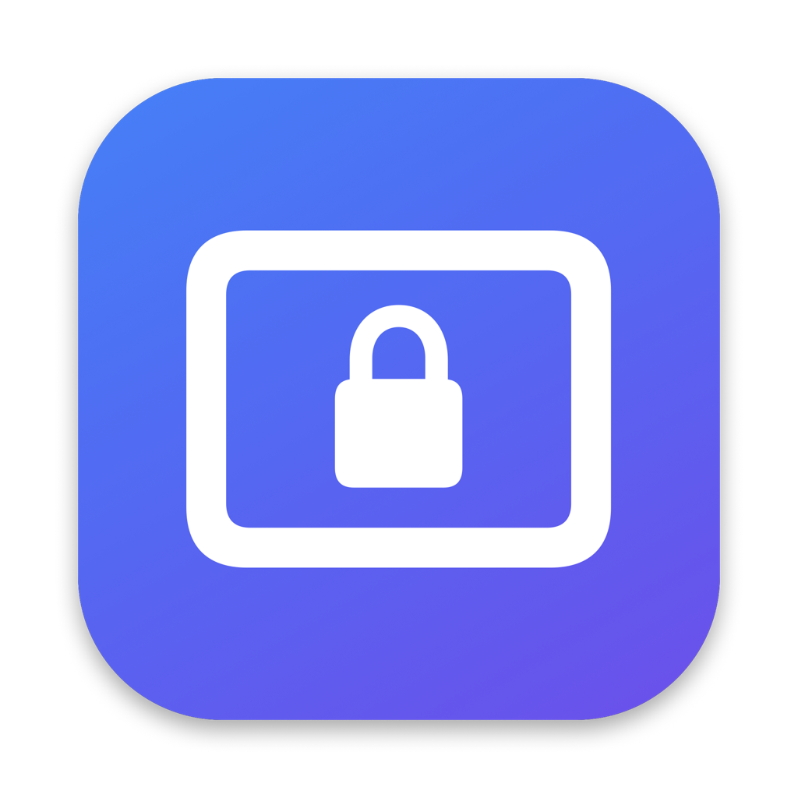

# ScreenLock



A tiny macOS menu-bar app that confines the mouse cursor to one display. Handy for full-screen games or remote-play sessions (e.g. League of Legends over UU 远程) where the cursor keeps escaping to a second monitor.

把鼠标锁在一块屏幕里的 macOS 菜单栏小工具，多屏打游戏/远程串流时防止鼠标跑到别的屏幕。

## 项目背景 / Background

在 Mac 上用**网易 UU 远程**玩LOL（英雄联盟）时，如果接了多块显示器，鼠标经常一甩就滑出游戏画面，跑到另一块屏幕上，团战里点个技能、拉个视角都可能失手。macOS 自带没有「把鼠标锁在一块屏幕」的开关，所以做了这个小工具：开局按一下 ⌥⌘L 锁住当前屏幕，打完再按一下解锁。

When playing League of Legends through NetEase UU Remote on a Mac with multiple displays, the cursor keeps sliding off the game window onto another monitor. macOS has no built-in way to keep the cursor on one screen, so ScreenLock was built to fix exactly that: press ⌥⌘L to lock the cursor to the current display, press again to release.

## Features

- Toggle with **⌥⌘L**, or pick a display from the menu-bar menu
- Template menu-bar icon that matches the system style (`rectangle` / `lock.rectangle`)
- Listen-only event tap: never rewrites mouse events, so dragging stays responsive; the cursor is pulled back only when it actually leaves the locked display
- No Dock icon (`LSUIElement`)

## Build

Requires Xcode command line tools (Swift).

```bash
./build.sh
open ~/Applications/ScreenLock.app
```

## Permissions

ScreenLock needs **Accessibility** access (System Settings › Privacy & Security › Accessibility). The build is ad-hoc signed, so after every rebuild remove the old entry and add the app again.

## License

MIT
